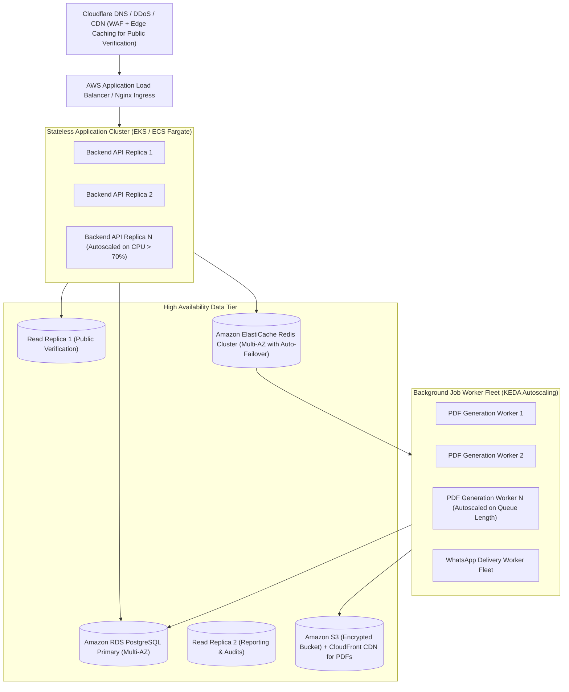

# CertiFlow – Production Deployment & Scalability Architecture

This document outlines the production architecture, scaling blueprint, fault-tolerance measures, and cost estimates for scaling **CertiFlow** to 100,000 registered users, 10,000 daily active users (DAU), 500 batch approvals/hour (~30,000 PDF certificates/hour), and thousands of public verification requests daily.

---

## 1. High-Level Scalability Architecture

---

## 2. Peak Workload Management (500 Approvals / 30,000 PDFs / 30,000 WhatsApp Messages in 1 Hour)

### 2.1 The Bottleneck Analysis
- 500 approvals in 1 hour with 60 candidates per batch = **30,000 PDF certificates** to render and **30,000 WhatsApp messages** to dispatch within 3,600 seconds.
- Rendering 1 PDF with embedded QR code takes ~25ms CPU time. 30,000 PDFs = 750 CPU-seconds.
- If executed synchronously within HTTP requests, the API servers would suffer massive thread starvation and timeout.
- Solution: **Asynchronous Producer-Consumer Pipeline with BullMQ and S3 offloading**.

### 2.2 Horizontal Scaling Strategy
1. **API Tier**: Autoscaled from 2 to 6 containers based on request rate. HTTP approval endpoints immediately update batch state in PostgreSQL, enqueue a BullMQ job, and return HTTP 200 within 40ms.
2. **Worker Fleet**: BullMQ workers scale horizontally using **KEDA (Kubernetes Event-driven Autoscaling)** based on queue depth (`bullmq_jobs_waiting > 100`).
   - 10 worker pods with concurrency of 5 each can process 50 concurrent PDF generations.
   - 30,000 certificates are completed in under 10 minutes.
3. **WhatsApp Rate Limiting**: The Meta WhatsApp Business API enforces rate limits (e.g. 80-250 msgs/second for Tier 3 accounts). The WhatsApp worker uses BullMQ's built-in `limiter` setting (`max: 100, duration: 1000`) to guarantee zero rate-limit bans.

---

## 3. Resilience & Fault Tolerance Handling

### 3.1 Redis Restart or Failure
- **Storage Strategy**: Amazon ElastiCache with Multi-AZ replication and automated failover (<30 second recovery).
- **Outbox Fallback**: If Redis becomes temporarily unreachable, state transitions are committed to a `job_records` table in PostgreSQL. When Redis re-establishes connection, an outbox poller replays pending generation tasks.

### 3.2 Worker Crash During PDF Generation
- Jobs in BullMQ are acknowledged only upon completion.
- If a worker crashes mid-generation, the BullMQ stall interval (`lockDuration: 30000`) expires, and the job is automatically reassigned to an available healthy worker.
- Idempotency guarantee: `CertificateService` verifies whether a certificate already exists in database before insertion, preventing duplicate PDF files.

### 3.3 WhatsApp Third-Party Outage
- WhatsApp deliveries are decoupled into a dedicated `whatsapp-notifications` queue.
- If Meta's API experiences downtime, jobs fail gracefully and retry using exponential backoff:
  - Attempt 1: Immediate retry after 5 seconds.
  - Attempt 2: Retry after 30 seconds.
  - Attempt 3: Retry after 2 minutes.
- If still unreachable, notifications are marked as `FAILED` in the database. When the carrier recovers, an admin can trigger batch replay via `POST /api/notifications/:id/retry`.
- Crucial hackathon scenario guarantee: **WhatsApp retries NEVER regenerate the certificate PDF.**

### 3.4 Slow Database Handling
- Public verification queries (`/api/public/verify/:id`) represent over 80% of read traffic.
- These queries are routed to read replicas or cached in Redis with a TTL of 1 hour.
- Write queries utilize indexed lookups (`@@index([batchId])`, `@@index([status])`) with connection pooling (e.g. Prisma connection pool / AWS RDS Proxy).

---

## 4. Certificate File Storage & Security

1. **Storage Tier**: Generated PDFs are uploaded to Amazon S3 (Server-Side Encryption `SSE-S3` or `SSE-KMS`).
2. **Access Control**: S3 bucket is completely private.
   - Authorized users download certificates via short-lived signed URLs (e.g. 15-minute expiration) generated by the API.
   - Prevents unauthorized web crawlers from scraping candidate certificates.
3. **Immutability (Write-Once-Read-Many)**: S3 Object Lock is enabled in compliance mode to prevent deletion or overwriting of issued certificates.

---

## 5. Monitoring & Observability

- **Metrics**: Prometheus & Grafana scraping metrics for:
  - HTTP request duration & error rates (p95, p99)
  - BullMQ queue wait time & active job count
  - Database active connections & transaction duration
- **Alerting**: Alertmanager triggering PagerDuty/Slack on:
  - SLA overdue batches > 0
  - WhatsApp queue failure rate > 5%
  - Database CPU > 80%

---

## 6. Estimated Monthly Cost Breakdown (AWS Production)

| Service | Specification | Monthly Cost (USD) |
| :--- | :--- | :--- |
| **AWS ALB** | Application Load Balancer | \$25 |
| **ECS / EKS** | 4x `t4g.medium` (Fargate or Spot/On-Demand mix) | \$95 |
| **Amazon RDS** | PostgreSQL `db.t4g.large` (Multi-AZ) + 1 Read Replica | \$160 |
| **Amazon ElastiCache** | Redis `cache.t4g.small` (Multi-AZ) | \$55 |
| **Amazon S3** | Standard Storage (~500GB storage + bandwidth) | \$25 |
| **Cloudflare** | Pro Plan (DDoS protection, WAF, Edge Caching) | \$20 |
| **Total Estimated Cost** | **Fully Scalable Production Infrastructure** | **~\$380 / month** |

### Trade-offs:
- *Serverless (Fargate) vs EC2*: Fargate eliminates container host patching and scales instantaneously during peak approval hours, with a slight 15% cost premium.
- *Managed Redis vs Self-hosted*: AWS ElastiCache eliminates Redis clustering maintenance and failover risks, guaranteeing BullMQ uptime.
